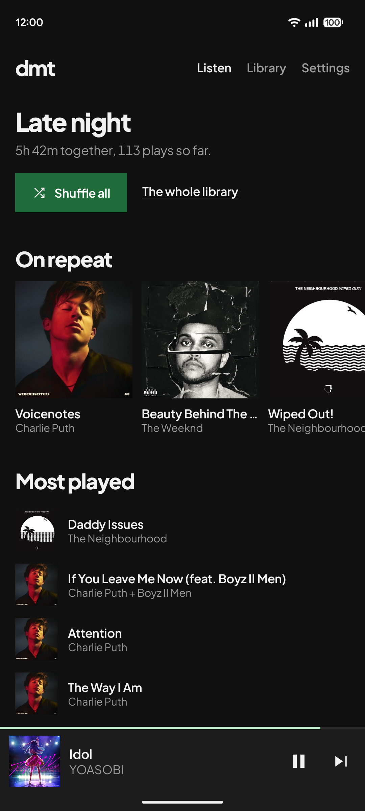
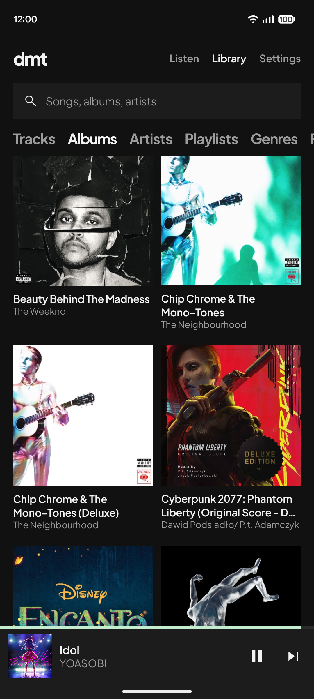
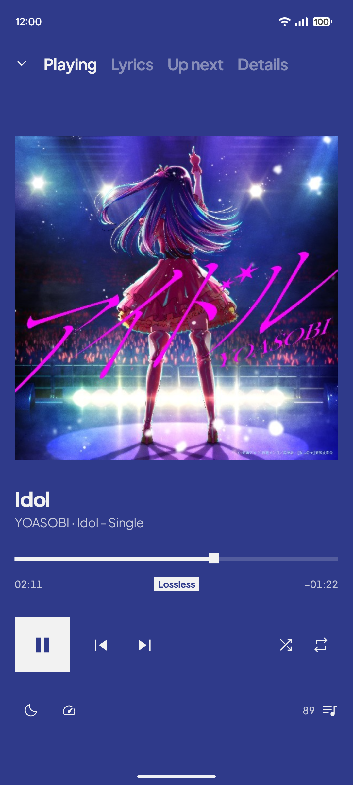
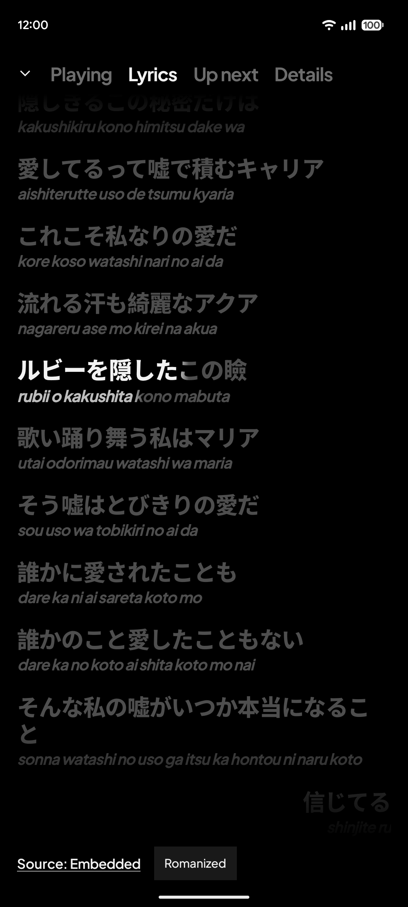
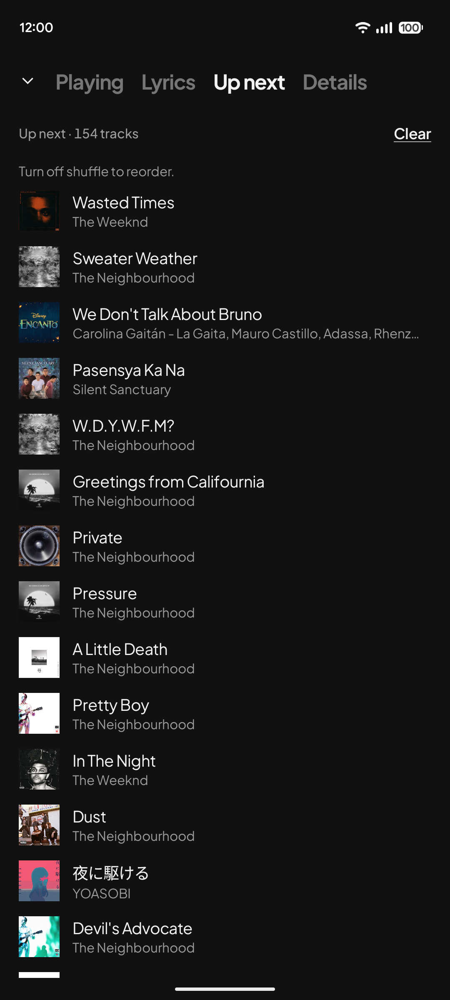
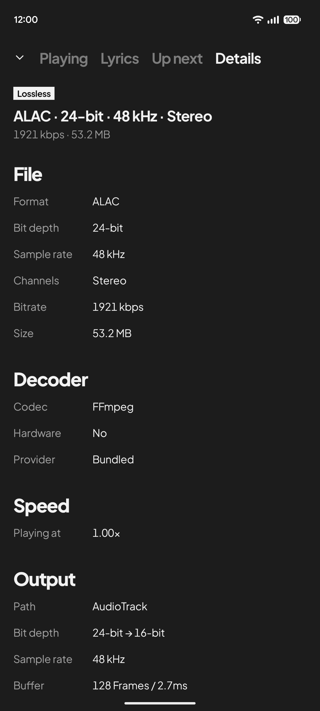

# dmt

**Dear music, thanks.** A music player for Android, for the music you own.

<table>
  <tr>
    <td width="33%"></td>
    <td width="33%"></td>
    <td width="33%"></td>
  </tr>
  <tr>
    <td width="33%"></td>
    <td width="33%"></td>
    <td width="33%"></td>
  </tr>
</table>

## Features

- **Your library, your way.** Tracks, albums, artists, playlists, genres and folders, with one
  search across all of them. Cue sheets split a single-file rip into real tracks.
- **Plays almost anything.** Bundled FFmpeg decoders, including Dolby AC-4, for formats Android
  cannot decode on its own.
- **Lyrics that follow the song.** Word-by-word synced lyrics from TTML and LRC in any script,
  with backing vocals, a colour for each singer and romanization. They come from the track's
  tags, a lyrics file next to it or your server, and from LRCLIB or lrc.red when you ask.
- **See the whole signal chain.** Format, decoder, speed, output and device, from file to
  speaker, with lossless, hi-res and Dolby badges worked out from the file itself.
- **A player that stays out of the way.** Sleep timer, playback speed, hold to seek, a queue you
  can reorder, and your last session restored on launch.
- **Everywhere you listen.** Media notification, system equalizer, volume levelling from
  ReplayGain and R128 tags, and Android Auto with voice search.
- **Flat and dark.** Every record is shown in its own colour, and the player takes the colour of
  the cover.

## Sources

| Source | What it plays |
| --- | --- |
| This device | Music files stored on this device |
| Jellyfin | Your own Jellyfin server |
| Navidrome | Navidrome, or any server that speaks the Subsonic API |

Server sources bring their covers, lyrics and format details with them. dmt keeps a sign-in
token, never your password.

## Privacy

No account, no ads, no analytics. Listening stats are counted on the device and never leave it.
dmt only goes online to reach your own server, to fetch lyrics from
[LRCLIB](https://lrclib.net) or [lrc.red](https://lrc.red) when you ask, and to stream animated
covers when you switch them on. With music on this device and animated covers off, dmt works
fully offline.

## Download

Get the latest APK from [Releases](https://github.com/imjyotiraditya/dmt/releases/latest).
dmt needs Android 11 or newer.

## Acknowledgements

Playback runs on [dmt-media3](https://github.com/imjyotiraditya/dmt-media3) and
[dmt-ffmpeg](https://github.com/imjyotiraditya/dmt-ffmpeg). Dolby AC-4 decoding uses Paul B
Mahol's decoder from librempeg. Type is Plus Jakarta Sans and icons are Material Symbols. See
[third-party notices](NOTICE.md) for every library and its license.

## License

dmt is released under the [GPL-3.0](LICENSE).
